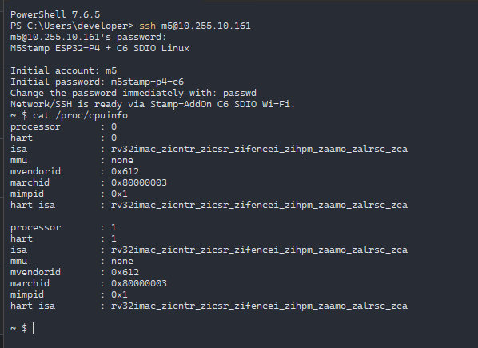

# M5Stamp ESP32-P4 + C6 SDIO Linux (dual-core SMP)

[](LICENSE)
[](https://m5stack.com)
[](https://github.com/tsuyoshi-otake/m5stamp-p4-c6-linux/releases)

A reproducible RISC-V NOMMU Linux 7.2 distribution (SMP on both cores of the ESP32-P4 since v0.4.0; releases up to v0.3.2 run on one core, see below) for the **M5Stack Stamp-P4** carrier board paired with **Stamp-AddOn C6** (via 4-bit SDIO interface).

Boots out-of-the-box into **Wi-Fi SoftAP mode** with automatic DHCP, Dropbear SSH server, BusyBox `vi`, MicroPython (`python3`), and a writable OverlayFS on `/home`, `/root`, and `/var/lib`.

<p align="center">
  
  <br>
  <em>Live SSH session on M5Stamp ESP32-P4 + C6 with both cores online (CPU0 and CPU1) via SDIO Wi-Fi.</em>
</p>

---

## Key Features & Verified Hardware Capabilities

- **SoC Target**: ESP32-P4 (Dual-Core RV32IMAC / ilp32, CPU clock 360 MHz as reported by the boot-shim, 32 MiB PSRAM, 16 MiB SPI Flash).
- **SMP**: Both cores are online (`Linux 7.2.11 #1 SMP riscv32 GNU/Linux`, `/sys/devices/system/cpu/online` = `0-1`). v0.4.0 boots both by default; releases up to v0.3.2 booted with `maxcpus=1`, because with two CPUs CPU1 stopped taking interrupts a few seconds into boot (#5): an interrupt frame that is never returned through leaves the CLIC interrupt level raised. Fix `0079` drops the level at interrupt entry (the 1-CPU image needs it too, see the known issue below), and `0080` fixes a console race that two CPUs exposed. With both, CPU1 kept taking interrupts on all 46 test boots, and a 60-minute load soak (699 kills of a busy task, plus SSH and HTTP transfers) ran without a hang. Tests with crashing programs found two more faults: a program's fault could lock its core up (`0081`, one CPU too, see the known issue below), and CPU1 ran without the memory protection ESP-IDF gives CPU0, so a fault there panicked the kernel (fixed in the boot-shim). With those fixes, 200,000 faults in a row completed on either CPU next to the loads that had triggered both, and 10 of 10 resets passed the boot checks; see `linux/tests/issue5-smp-2026-10-19.md`. Saving the USB drive also rebooted a 2-CPU board, because the kernel's flash write (`0072`) refused to run with CPU1 online; it now holds CPU1 with interrupts off for each flash operation (`stop_machine()`), so saves go to flash without a reboot, and it spaces those operations out so that Wi-Fi keeps up (#43). Two CPU-bound programs at once take 8.1–8.3 s where one CPU takes 16.0 s, and fork+exec gains little. A signal delivered to a handler cost 1.7 to 1.8 times as much as on one CPU, because the kernel flushed the other CPU's instruction cache through an IPI for each one; `0083` returns through the kernel's own sigreturn code instead, and 40,000 handled faults take 0.7 s on either CPU (1.49 s on one CPU without it; #44). A 1-CPU image needs `C68_MAXCPUS=1` at build time; `maxcpus` in `/boot/config.txt` is informational and is not read by anything.
- **Wi-Fi Companion**: ESP32-C6 (M5Stack Stamp-AddOn C6) connected via 4-bit SDIO (5 MHz by default, up to 40 MHz with `sdio_mhz=`, see [SDIO clock](#c6-firmware-security-features--regulatory-notes)).
- **Out-of-the-Box SoftAP**:
  - Broadcasts a per-device SSID **`m5-XXXX`** with a WPA2-PSK passphrase generated on first boot (see [Per-device credentials](#per-device-credentials)).
  - Integrated `udhcpd` DHCP server assigning client IPs in `192.168.4.2` – `192.168.4.20` (Gateway: `192.168.4.1`).
- **Pre-installed Developer Tools**:
  - **SSH Server**: Password-enabled Dropbear on TCP port 22 (user `m5`, per-device password from `credentials.txt`). inetd accepts up to 20 new connections a minute, then stops listening for 60 s.
  - **`vi` Editor**: Full-featured BusyBox `vi` with search, undo, visual buffers, and syntax assistance.
  - **Shell commands**: the main BusyBox carries the shell and the commands scripts use (`grep`, `sed`, `find`, `ps`, `df`, `dmesg`, `ping`, `nc`, ...). `/bin/sh` is BusyBox hush (ash needs an MMU), patched so that `set -e` follows POSIX, also in `( … )` and `$(…)` subshells, which hush runs by executing itself again on this NOMMU system (#41). The m3-lab image adds `busybox-tools`, a third BusyBox with about 65 everyday commands the main one leaves out to stay under the 512 KB NOMMU allocation: `awk`, `less`, `top`, `free`, `uptime`, `pgrep`/`pkill`, `watch`, `timeout`, `stat`, `diff`, `patch`, `hexdump`, `xxd`, `tar`, `gzip`, `unzip`, `wget` (HTTP only), `nslookup`, `traceroute`, `ip` and more. It is loaded only while one of them runs (about 430 KB of the user pool). `sudo`, `nano`, `curl`, `file`, `dig` and `lsblk` are not available: they need an MMU, a wide-character toolchain or more RAM than the board has. `su` exists (#37): it is a small setuid BusyBox (`/bin/busybox-su`) and asks for `root_password=` from `credentials.txt`; every attempt is logged to `/run/messages` (`su: + pts/0 m5:root`, `-` for a failure). SSH logins with a terminal are recorded as on other Linux systems: `who`, `w` and `users` show who is logged in (`/var/run/utmp`), `last` lists past logins (`/var/log/wtmp`), and `uptime` counts the users. `wtmp` is kept on the 2 MB `/tmp` ramdisk, so Dropbear rotates it to `wtmp.1` at 32 KiB (about 85 logins in the two files; `last -f /var/log/wtmp.1`); both start empty at every boot. If the ramdisk is full, logins still work but are not recorded until space is freed. Root over SSH is key-only — put a `root_authorized_keys` file on the USB drive — and the USB-C serial console stays an unauthenticated root shell. The SSH login message (`/etc/motd`) lists the common commands by group; `busybox --list` and `busybox-tools --list` print everything. `ping` is BusyBox's small variant: `ping HOST` prints `HOST is alive!` and takes no options such as `-c`. `traceroute` needs a raw socket, so it works only as root.
  - **MicroPython (`python3`)**: MicroPython v1.22.2 compiled with bFLT Load-to-Ram (`-r`) and position-independent code (`-fPIC`) for stable NOMMU execution. It has the unix port's standard modules (`time`, `socket`, `select`, `json`, `re`, `struct`, `random`, `hashlib`, `binascii`, `collections`, `asyncio`, ...) without threads, TLS, `ffi`, `framebuf` or complex numbers, to stay under the 512 KB NOMMU allocation.
  - **Pico-style autorun**: `main.py`, `main.sh` or a bFLT `main` saved on the USB drive runs as `m5` at boot and restarts when a new version is saved ([details](#5-autorun-from-the-usb-drive-pico-style)).
  - **Deep Sleep**: `deepsleep 60` (or `deepsleep.sleep()` in MicroPython) turns the C6 off and puts the P4 into Deep Sleep until a timer, an LP GPIO or a chip temperature limit (checked by the LP core while asleep) wakes it; the board then boots Linux again and `/sys/kernel/board/wake_reason` says why. 1 KB of sleep memory and the clock carry over ([details](#6-deep-sleep)).
  - **Writable Filesystem (OverlayFS)**: While the root filesystem is SquashFS (read-only for durability), RAM-backed OverlayFS is mounted on `/home`, `/root`, and `/var/lib` so users can create and edit scripts during the current boot. Its contents are lost when power is removed.
  - **USB Mass Storage (`/boot` drive, optional hardware)**: With the [optional USB carrier](#optional-hardware-usb-mass-storage-carrier), its Type-A USB connection (GPIO26/27) exposes a FAT-formatted 256KB `/boot` configuration drive to Windows/Mac/Linux hosts. Save a file and, a few seconds later, the board validates the drive, applies the settings and writes it to redundant A/B flash slots. No eject or reboot is needed.
- **Kernel & SoC Stabilization**:
  - Full-Speed DWC2 USB OTG driver hardened with PIO mode and dedicated TX FIFO empty interrupt management, eliminating descriptor DMA coherency panics and enabling stable multi-block transfers.
  - Signal delivery `mcause` hardening (`0014`).
  - L2 unified cache & DMA reentrancy hardening (`0015`).
  - Systimer 52-bit atomic multi-word read and missed-alarm mitigation (`0016`).
  - Dual-core systimer lock and CPU1 context switch tracking (`0042`, `0044`, `0045`, `0046`).
  - CLIC interrupt level dropped at interrupt entry (`0079`, #5), so a task switch at the end of an interrupt can no longer leave a core deaf to every interrupt; and a locked USB console transmit path (`0080`) for two CPUs.
  - MEXSTATUS.EXPT_VLD cleared at exception entry (`0081`, #5), so a program's fault can no longer lock the core up; and CPU1 gets CPU0's PMA/PMP memory protection from the boot-shim, so a user fault on CPU1 is caught at the faulting instruction instead of panicking the kernel.
  - Signal handlers return through the kernel's own sigreturn code (`0083`, #44), so a handled signal no longer flushes the other CPU's instruction cache through an IPI.
  - USB CDC-ACM 64-byte TX FIFO bounded polling (`0062`), eliminating full-screen editor (`vi`) and TUI terminal lockups. Since `0082` (#42) the end of the output no longer waits half a second, and kernel messages are sent once per write instead of per character: when the host stops reading, the console gives up after one 50 ms wait instead of a wait per character, and counts what it drops in `/sys/class/tty/ttyGS1/console_dropped`.
  - Early CRNG entropy initialization via `seedrng` on OverlayFS, preventing `getrandom()` system call stalls.
  - SDIO DW-MMC host controller driver enhancements with software DTO and buffer pacing (`0032`, `0033`, `0060`, `0061`).
  - NOMMU system-call pointers (`0071`): a pointer that is not in PSRAM or the memory-mapped root filesystem now fails with `EFAULT`. Before, the kernel read it itself; `vi` with no file name passes a NULL path and froze the board until the watchdog reset it.
  - NOMMU user memory: programs load into a 10 MB reserved pool in two regions (6 MB + 4 MB, `0070`) instead of the fragmented page allocator, so SSH logins, `S40network restart` and console commands no longer routinely fail with `nommu: Allocation of length … failed` under normal load (#23). Since v0.4.2 the pool keeps a reserve for the system (`0089`–`0091`, #51): the allocator takes the smallest block that fits (best-fit), and a program started from an SSH login or the console is refused when it would leave less than 1.2 MB contiguous or 2 MiB in total free in the pool (it then falls back to the page allocator and may fail alone, `user_denied` in `nommu_pool`). Network scripts, `bootsync` and the watchdog run through `run-system`, which marks them as system work, so a `config.txt` save or `S40network restart` started by a user no longer starves `wpa_supplicant` (1.85 MB contiguous). In the 5-restart tests on STA the system side had no real out-of-memory failure (11 before the fix, 0 after), at the cost of fewer concurrent user sessions at the edge; an unlucky user program can still fail with that message, and running it again works (#40/#49). `nommu_pool` also reports `user_denied`, `system_alloc_fail`, `user_reserve_contig` and `user_reserve_total`. `/sys/kernel/board/nommu_pool` (`0076`) reports the pool's `total`, `used`, `largest_free`, `alloc_fail` and `fallback` so exhaustion is visible without aggregating `/proc/*/maps`; the same fields appear in `sysinfo` and `status.txt`. To keep reload-time peaks low, `config.txt` saves now apply only the keys that changed (boot-only keys no longer restart Wi-Fi), applies are serialised, the udhcpc hook chain runs in one shell, and wait loops use a FIFO `read -t` instead of forking `sleep` (#39/#40). Each BusyBox process still takes about 500 KB, because bFLT programs do not share their text. The m3-lab image therefore runs init, inetd, syslogd and udhcpd from `busybox-daemons`, a second BusyBox built with only those four applets (192 KB each). At idle that leaves about 1 MB more of the pool free, which is one more concurrent SSH session (5–6 instead of 4–5; `linux/tests/busybox-daemons-2026-10-16.md`). `MemAvailable` does not change, because it does not count the pool.

---

## Serial Access, Troubleshooting & Recovery

Linux / macOS serial examples, how to open the console without resetting the board, troubleshooting and flash backup / recovery are in [docs/troubleshooting.md](docs/troubleshooting.md).

## C6 Firmware, Security Features & Regulatory Notes

- **C6 firmware**: Linux expects the ESP32-C6 to run ESP-Hosted NG 1.0.6 (the driver logs `ESP-Hosted Version: NG-1.0.6.0.1`). The release images flash the P4 only; a C6 running another version may fail to attach over SDIO. Check the version in the boot log: a mismatch is logged as `Incompatible ESP Host-firmware release detected` with both versions, and no log line at all means the C6 is not running ESP-Hosted NG. See [Updating the C6](#updating-the-c6).
- **SDIO clock**: the driver requests 5 MHz unless `sdio_mhz=` in `config.txt` picks 1, 2, 10, 20 or 40 (applied at the next boot, logged as `ES_SDIO_CLOCK_APPLY requested_mhz=...` in dmesg). The DTS caps the bus at 40 MHz, and the MMC core enumerates the C6 at 20 MHz before the driver sets its rate. Measured in station mode over the home Wi-Fi (`linux/tests/sdio-clock-2026-10-16.md`): PC to board over raw TCP 300–330 KB/s at 5 MHz, 410–440 KB/s at 40 MHz; SSH 210–220 KB/s at 5 MHz, about 250 KB/s at 40 MHz, where Dropbear's crypto on one 360 MHz core is the limit. 40 MHz passed the boot checks on 10 resets; it has not been soaked for hours, so 5 MHz stays the default (#21).
- **Secure Boot and flash encryption are disabled.** Physical access allows reading the flash (including Wi-Fi credentials in the boot FAT) and writing arbitrary firmware. See [SECURITY.md](SECURITY.md).
- **Wi-Fi regulatory domain**: no `country=` is set by default, so the world regulatory domain applies. Set `country=` in `config.txt` for your region.
- **Wi-Fi security**: WPA2-PSK only. Protected management frames are opt-in (`wifi_pmf=1`); in station mode the v0.2.2 image joined an access point with it, while a SoftAP client negotiating PMF has not been tested. WPA3-SAE is not built.

### Updating the C6

The C6 on the Stamp AddOn has no USB port of its own; it is updated over the SDIO link from the P4 with a temporary P4 updater image, after which the Linux image is written back.

1. Build the C6 image: `bash linux/m2/build-c6.sh --vendor <out>` (needs the locked ESP-IDF; `C6_BT=0` leaves out BLE, which Linux does not use). `<out>/C6_PATCH_MANIFEST.txt` records the `network_adapter.bin` SHA-256 and the applied patches.
2. Build the updater: `bash linux/m2/build-ota-host.sh <external-source-root> <out>/build/network_adapter.bin <ota-out>` (the source root holds `esp_idf` and an `esp_hosted_mcu` checkout). It uses ESP-Hosted-MCU's `host_performs_slave_ota` example.
3. Save a full 16 MB readback of the P4 first, then write the updater with `linux/m2/ota-host/flash-ota-host.ps1` (it refuses to run without `-AllowCandidateWrite` and a matching stock readback). The updater sends the C6 image over SDIO on its next boot.
4. Write the Linux release image again and check the boot log for `ESP-Hosted Version: NG-1.0.6.0.1`.

`tools/readback-c6-ng.ps1` reads the C6 flash through a C6 programmer port, if you have one wired, so the original C6 firmware can be kept. The SDIO update path was used during bring-up (`linux/tests/wlan0-regression-bisect-2026-08-12.md`); it is not part of the release workflow.

## Security Design

The release images are set up as a development board. The security model (#60–#62) is:

- **Two boundaries.** Over the network everything needs authentication: Wi-Fi is WPA2-PSK, SSH needs the per-device random password or a key, and the only other service is mDNS. Over USB, whoever can plug in has the owner's rights: the serial console is a root shell, the drive holds `credentials.txt` and runs `main.py` at boot, and esptool can rewrite the flash. Keeping the board in your hands is the boundary.
- **Code running on the board owns the whole device.** User programs run in RISC-V machine mode (M-mode), like the kernel, so any program can write kernel memory, CSRs, peripherals and the flash. The `m5`/root split and `su` keep mistakes apart; they do not stop an attacker.
- **Why user programs do not run in U-mode.** The ESP32-P4 has U-mode and PMP memory protection, and both work on v1.3: a kernel that returned to user programs in U-mode passed 21 boots and two 30-minute load runs (#61). It would still not stop an attacker:
  - Without an MMU every process shares one memory pool, so a compromised `m5` program can rewrite a root daemon (Dropbear, inetd) and become root, and root can load kernel modules or write the flash through `/dev/mtd`.
  - ESP-IDF's startup code in the boot shim locks 14 of the 16 PMP entries, and the locked entries let U-mode read and write the peripherals, including the SPI flash controller.

  U-mode would only make the kernel more robust against buggy programs, at the cost of reworking the boot shim's PMP setup and the user memory allocator. It stays a later option, mainly for v3.x silicon (32 PMP entries). M-mode userspace (`0031`) also avoids an `mret` interrupt race seen on v1.0 silicon.
- **Most ESP32 products work the same way.** Their firmware is one trust domain too; a product protects it with Secure Boot, flash encryption, closed debug ports and signed updates rather than process isolation. Those are off here because they burn eFuses, which cannot be undone, and they would remove the recovery path, the USB drive configuration and autorun. [docs/security-hardening.md](docs/security-hardening.md) lists what a product build needs, and [SECURITY.md](SECURITY.md) lists the known limitations.

## Default Credentials & Connection

| Service | SSID / Host | Username | Password | Notes |
| :--- | :--- | :--- | :--- | :--- |
| **Wi-Fi SoftAP** | `m5-XXXX` | — | `psk=` in `credentials.txt` | WPA2-PSK, 2.4 GHz 802.11b/g/n, channel 1/6/11 |
| **SSH (`dropbear`)**| `192.168.4.1:22` | `m5` | `password=` in `credentials.txt` | Default user with home directory `/home/m5` |
| **SSH (root)** | `192.168.4.1:22` | `root` | key only | Needs `root_authorized_keys` on the USB drive; password login for root is always off (#37) |
| **Runtime status** | SSH / serial | — | — | Read `/run/status.txt`; the USB FAT image is not modified while exported |
| **Serial Console** | `COMx` (115200 8N1) | *(root shell)* | *(none)* | `ttyGS1` over USB-Serial/JTAG. Press `Enter` to activate |

### Per-device credentials

Every board gets its own credentials on first boot; no SSID or password is shared between boards.

- On first boot `S05tmpfs` writes `credentials.txt` to the USB drive: `device_id=`, `password=` (SSH/console password of user `m5`), `root_password=` (the `su` password, #37), and, while `wpa_supplicant.conf` is still the shipped default, `ssid=m5-<device_id>` and `psk=`. A `credentials.txt` written by an older image has no `root_password=`; the board generates one and appends it on the first boot of this image. That `wpa_supplicant.conf` is rewritten with the new SSID and passphrase, and `channel=` (1, 6 or 11, chosen from the device id) is added to `config.txt`.
- The same values are printed once on the serial console as `ES_CREDENTIALS NEW: ...` and are readable as root in `/tmp/credentials.txt`. **The serial log then contains the password; redact that line before sharing logs.**
- The generated files are written to flash during that first boot (`ES_CREDENTIALS: saved to flash` in the serial log).
- `password=` is applied to user `m5` at every boot, and `root_password=` to `root` for `su` (#37). To change one, edit it (8-64 characters, no `:`) in `credentials.txt` and save it; the board applies it a few seconds later. An invalid `root_password=` keeps root locked (`root:!`). `passwd` over SSH only lasts until the next boot.
- There is no forced password change at first login: the password is already random per device, and the image has no built-in fallback password. If `password=` cannot be applied (`ES_CREDENTIALS` on the console), password login for `m5` stays disabled; SSH keys still work.
- `channel=` (1-13) in `config.txt` sets the SoftAP channel without editing `wpa_supplicant.conf`.
- A custom `wpa_supplicant.conf` (one that is not the shipped `m5` / `m5stamp-p4-c6` default) is never overwritten; only `password=` is generated then.
- **Factory reset**: put an empty file named `factory-reset` (or `factory-reset.txt`) on the USB drive. A few seconds later the board reboots, the drive is restored to the shipped defaults (`ES_FACTORY_RESET` in the serial log), and new credentials are generated and saved like on any first boot. This is the only drive change that reboots the board.
- **SSH keys**: put an OpenSSH `authorized_keys` file on the USB drive; a few seconds later it is installed as `/home/m5/.ssh/authorized_keys`, and again at every boot (`ES_SSH_KEYS` in the serial log). With keys installed, `ssh_password_auth=no` in `config.txt` makes Dropbear accept keys only. Without any installed key that setting is ignored so a mistake cannot lock you out. Deleting `authorized_keys` from the drive revokes the keys it installed a few seconds later; with `ssh_password_auth=no`, password login comes back at the next boot.
- **root SSH keys**: a `root_authorized_keys` file on the USB drive is installed as `/root/.ssh/authorized_keys` the same way, and Dropbear then accepts `ssh root@...` by key only — password login for root is always disabled (`dropbear -g`, `root:!`). This is the equivalent of Debian's `PermitRootLogin prohibit-password`. To turn root SSH back off, delete the file: the keys it installed are revoked a few seconds later. `/home` and `/root` are on the 2 MB `/tmp` ramdisk, of which 2% is reserved for root so that a user who fills it cannot block these updates; if the keys still cannot be written, the serial log says `ES_SSH_KEYS FAIL` and no keys from that file stay installed until the next save or boot.

---

## Quick Start: Flash Pre-Built Release Binaries

### 1. Download Release Package

<!-- 55b keep -->
> **v0.5.0** is built and published the same way as v0.4.3: the tag run refuses any asset
> whose hash is not in `linux/tests/v0.5.0-hardware-validation-2026-10-29.md`.
> Changes since v0.4.3:
> - Deep Sleep (#56): `deepsleep` from the shell and the `deepsleep` module in MicroPython.
>   The board sleeps at about 0.33 mA and wakes on a timer or on wake pins;
>   it keeps 1 KB of sleep memory and the clock across the sleep (see "6. Deep Sleep").
> - Temperature wake (#57): the LP core watches the chip temperature while the board sleeps.
> - Your own LP core program (#59): `lp_core=` and `lp_program=` in `config.txt` run it
>   always or only while asleep; Linux reads its variables in `/sys/kernel/board/lp_core/`
>   or with the `lpcore` module (see "7. LP core program").
> - The boot no longer waits about 50 s when nothing reads the USB serial port (#58).
> - The one-release aliases from v0.4.3 are gone: the `easystick-*` commands,
>   `easystick.local`, `/run/easystick-status.txt` and `/sys/kernel/easystick/` no longer
>   exist. Use the names below.
>
> **v0.4.3** is built and published the same way as v0.4.2: the tag run refuses any asset
> whose hash is not in `linux/tests/v0.4.3-hardware-validation-2026-10-24.md`.
> Changes since v0.4.2: the names now describe what each part does,
> and `easystick` is gone (#55): the hostname is `stamp-p4` (`stamp-p4.local`), the USB drive is
> `STAMP_P4`, and the commands are `sysinfo`, `autorun`, `update-status`, `run-system`, `bootsyncd`,
> `respawn` and `mdnsd`. The status file is `/run/status.txt` and the kernel knobs are in
> `/sys/kernel/board/`. The DTB is `esp32p4-m5stamp-p4.dtb`, and the build flags have no prefix
> (`NOMMU_POOL_BESTFIT`, `C68_MAXCPUS`, `LEGAL_INFO`, …). For one release the old names still
> work: `easystick-*` commands, `easystick.local`, `/run/easystick-status.txt` and
> `/sys/kernel/easystick/`. A drive whose `config.txt` sets `hostname=easystick` keeps that name.
> udhcpc now runs from a small BusyBox of its own, which frees about 340 KB of the pool at idle (#45).
> The v0.4.2 and older zips hold the DTB as `easystick-stamp-p4.dtb`.
<!-- 55b keep end -->
>
> **v0.4.2** is built and published the same way as v0.2.2 to v0.4.1: the assets
> are the CI build that was flashed and checked on hardware, and the tag run refuses
> any asset whose hash is not in `linux/tests/v0.4.2-hardware-validation-2026-10-23.md`.
> Changes since v0.4.1:
> - SSH sessions no longer crash after a key exchange (#54).  OpenSSH 10
>   negotiates the hybrid ML-KEM-768 key exchange, which needs more than
>   Dropbear's 32 KB stack; a NOMMU program has no guard page, so the overflow
>   corrupted the C library's signal table and the next signal ended in
>   `unhandled signal 4`.  `dropbear` and `dbclient` now get a 256 KB stack
>   (`flthdr -s`), which costs about 224 KB of pool per SSH session (#52 will
>   shrink it).  `0012` also makes a vfork child that cannot exec leave with
>   `_exit(127)` without touching the parent's memory.
> - The memory pool keeps a reserve for the system (#51, #50): best-fit
>   allocation, a 1.2 MB / 2 MiB watermark for programs started by a user,
>   and `run-system` for the network and watchdog scripts.  A network
>   restart that overlapped several SSH sessions gave 11 real out-of-memory
>   failures in the system's own programs before, and none after.
> - `linux/flash-candidate.ps1` leaves the boot slots alone by default; `-WriteBoot`
>   writes them (a flash used to overwrite the saved Wi-Fi settings).
> - Memory measurements: `linux/tests/nommu-mem-harness.py` and
>   `linux/tests/issue50-51-memory-2026-10-21.md` (#50).
> - The 10 MB pool is still shared by about 4–6 SSH sessions; the plan to
>   cut each program's size is #49.  #43 (a C6 firmware change) is not part of this release.
>
> Changes in v0.4.1 since v0.4.0:
> - Short SDIO reads are no longer corrupted (#35).  The P4's SDMMC FIFO does
>   not advance when the CPU reads it, so a programmed-I/O read of more than
>   one 32-bit word returned its first word repeated.  Wi-Fi packets whose
>   length leaves a 5–15 byte tail took that path (17–29 times in one
>   5 × 10 MB download run).  `0087` and `espressif,fifo-no-pop` in the DTS
>   send those reads through the DMA engine with a bounce buffer
>   (`dw_mmc.es_fifo_bounce=0` turns it off).  Throughput and latency did not
>   change measurably.  Register reads stay on CMD52 (`0012`): 4-byte CMD53
>   register reads misread the packet length under load.
> - A network restart runs fewer programs (#40): `S40network`,
>   `update-status` and the udhcpc script use shell builtins and
>   skip the SSH restart when inetd runs.  The sampled process peak during a
>   restart did not drop measurably; #40 stays open.
>
> Records: `linux/tests/v0.4.1-hardware-validation-2026-10-21.md`; the #35
> analysis is in issue #35.
>
> v0.4.0 changes since v0.3.2:
> - Both CPUs are online by default (#5). Releases up to v0.3.2 booted with
>   `maxcpus=1` because CPU1 stopped taking interrupts a few seconds into boot;
>   `0079`, `0080`, `0081` and a boot-shim fix that gives CPU1 the same PMA/PMP
>   memory protection as CPU0 make it reliable.  A 1-CPU image still builds
>   with `C68_MAXCPUS=1`.  (`linux/tests/issue5-smp-2026-10-19.md`)
> - BusyBox hush follows POSIX `set -e` (#41): a skipped `&&`/`||` list no
>   longer switches it off for the rest of the script, a `while`/`until`
>   condition or a `! pipe` that is false no longer ends the script, and on
>   NOMMU `( … )`, `$(…)` and pipelines inherit `set -e`, `set -x` and
>   `pipefail`.  `S40network` no longer uses `set -e`.
> - The ttyGS1 console no longer stalls half a second at the end of a write
>   (#42): it finishes from the interrupt, and a host that stops reading
>   costs one 50 ms wait instead of one per character; dropped characters
>   are counted in `/sys/class/tty/ttyGS1/console_dropped`.
> - Saving the USB drive no longer stalls Wi-Fi (#43).  A flash commit
>   writes only the sectors that changed and sleeps between the ROM calls,
>   so the CPUs stay free at least half the time, and the SDIO path wakes
>   the Wi-Fi transmit thread when a frame is queued and runs it, the
>   receive workqueue and the interrupt work at raised priority.  UDP probes
>   sent during commits got their reply after a median of 1.44 s, and 86 of
>   5,500 were lost; on the fix build and the release image the median is
>   21–45 ms.  Bursts of 2–6 lost probes and replies held for up to about
>   1 s remain in some runs, most likely on the C6, and one run held replies
>   for 5.4 s without a known cause; #43 stays open.
> - Handled signals are no longer slower on two CPUs (#44): the handler
>   returns through the kernel's own sigreturn code instead of flushing the
>   other CPU's instruction cache for every signal.  40,000 handled faults
>   take about 0.7 s on either CPU, against 2.5–2.7 s before.
> - Filling the 2 MB `/tmp` ramdisk can no longer make a saved
>   `root_authorized_keys` look installed when it is not (2% is reserved
>   for root; the serial log says `ES_SSH_KEYS FAIL`).
> - MicroPython raises `RuntimeError` on deep recursion instead of crashing
>   (48 KB stack), and exits with `MemoryError` when its heap cannot be
>   allocated.
> - A `config.txt` save applies only the keys that changed instead of
>   restarting the network (#39), `country=` included; a deleted
>   `hostname=` goes back to the boot name, and a PSK fixed by a reload gets
>   a DHCP lease.  The NOMMU process pool is shown in
>   `/sys/kernel/board/nommu_pool` (#40), a failed SSH key install
>   fails closed, and the loopback interface comes up at boot.
>
> Records: `linux/tests/issue5-smp-2026-10-19.md`,
> `linux/tests/issue39-40-hardware-checks-2026-10-19.md`,
> `linux/tests/issue41-44-2026-10-20.md` (the #41–#44 fixes and the #43
> latency work).
>
> v0.3.2 changes since v0.3.1 (#37):
> - `su` works: `root_password=` in `credentials.txt` (generated on the first boot,
>   or appended to an older `credentials.txt`) is the root password for `su`.
>   Every attempt is logged to `/run/messages`; a missing or invalid
>   `root_password=` keeps root locked, and `su` then fails cleanly.
> - Root over SSH by key only: a `root_authorized_keys` file on the USB drive is
>   installed for root; password login for root stays off.
> - Deleting `authorized_keys` or `root_authorized_keys` from the drive revokes the
>   keys it installed a few seconds later (keys added by hand are kept).
> - SSH logins are recorded in `/var/run/utmp` and `/var/log/wtmp`: `who`, `w`,
>   `users` and `last` are new, and `uptime` counts the users.  `wtmp` rotates to
>   `wtmp.1` at 32 KiB, and both start empty at every boot.
> - The image now has two setuid files, the main BusyBox and `/bin/busybox-su`;
>   the build checks both in the squashfs.
>
> **Known issue in v0.3.2:** a user can fill the 2 MB `/tmp` ramdisk (shared with
> `/home` and `/root`); a `root_authorized_keys` saved while it is full is not
> installed, although the serial log says it is.  Free the space and save the file
> again, or reboot.  Fixed in v0.4.0 (2% reserved for root, `ES_SSH_KEYS FAIL`;
> `linux/tests/v0.3.2-followup-checks-2026-10-19.md`).
>
> **Known issue in v0.3.2 and earlier (#5):** killing a program while it is busy on
> the CPU (for example `kill` of a running `yes`) can stop the board until the
> watchdog resets it one to two minutes later.  A program that crashes (SIGSEGV)
> can stop it the same way, depending on what else runs on the CPU.  Fixed by
> `0079` and `0081` in v0.4.0
> (`linux/tests/issue5-smp-2026-10-19.md`).
>
> v0.3.1 changes since v0.3.0:
> - A `main.sh` saved with CRLF line ends runs again (#34). On v0.2.5 and v0.3.0
>   it failed with `syntax error`, because the step that strips CR never ran.
>   The kernel is built from the same source and the DTB is unchanged.
> - Dual-core (`maxcpus=2`) was checked on 7.2: 3 of 10 boots were usable (#5),
>   so it stays experimental and off.
>
> v0.3.0 changes since v0.2.5 (#36):
> - The kernel moves from Linux 6.18.35 to **7.2.11**.  The board patches were
>   ported to 7.2; the user-visible behaviour is meant to be the same as v0.2.5
>   and the same hardware checks pass.
> - Four fixes were needed on top of the port, all on paths that upstream does
>   not test without an MMU: the NOMMU process-memory pool registers with the
>   new reserved-memory API (the first 7.2 build stopped at boot), `/dev/mem`
>   `mmap` works again on NOMMU (the drive save and `devmem` use it), the
>   preemption model stays `PREEMPT_NONE` as on 6.18, and the Wi-Fi driver names
>   `WQ_PERCPU` for its workqueues.
> - The 6.18 line was also updated to 6.18.57 and checked on hardware
>   (`linux/tests/linux-6.18.57-hardware-validation-2026-10-18.md`, branch
>   `kernel-6.18.57`).  It is kept as the fallback and is not released.
>
> **Known issue in v0.2.3 and earlier:** `vi` started without a file name freezes
> the board until the watchdog resets it; start `vi` with a file name
> (`vi notes.txt`) on those releases.
>
> v0.2.2 added the A/B `/boot` slots and metadata (`boot_alt`, `bootmeta*`) that the
> `v0.2.1-smp` binaries lacked (#8), a debug bundle (`System.map`, `vmlinux`) and
> the GPL corresponding source (`*-legal-info.tar.gz`, #31).

Download either the monolithic 16MB raw flash image or the partition zip package from the [Releases](https://github.com/tsuyoshi-otake/m5stamp-p4-c6-linux/releases) page:
- **`m5stamp-p4-c6-linux-smp-v0.5.0-16mb.bin.gz`**: Single 16MB raw flash image (simplest, flash to `0x0`).
- **`m5stamp-p4-c6-linux-smp-v0.5.0.zip`**: Individual partition binaries with automated PowerShell flash script.

### 2. Flash using `esptool.py`

Connect the M5Stamp-P4 via its USB-C port to your computer. Identify your serial port (e.g., `COM10` on Windows or `/dev/ttyACM0` on Linux/macOS).

#### Option A: Monolithic 16MB Raw Image Flash (Recommended)
```bash
gzip -d m5stamp-p4-c6-linux-smp-v0.5.0-16mb.bin.gz
esptool.py --chip esp32p4 --port COM10 --baud 460800 write_flash 0x0 m5stamp-p4-c6-linux-smp-v0.5.0-16mb.bin
```

#### Option B: Release PowerShell Script
```powershell
.\flash-candidate.ps1 -Port COM10 -AllowCandidateWrite
```

The boot slots (boot FS with user Wi-Fi config) and A/B bootmeta are preserved
by default; pass `-WriteBoot` to write `boot.img` and reset the A/B selection.
`-WriteBoot` is required for the first upgrade from v0.2.1-smp or older, which have
no A/B slots. The default (no flag) is only for reflashing a v0.2.2 or later
installation whose A/B slots and metadata are already initialized.
`-PreserveBoot` is still accepted for compatibility and is a no-op.

#### Option C: Manual Multi-Partition Flash
```bash
esptool.py --chip esp32p4 --port COM10 --baud 460800 \
    --before default_reset --after no_reset write_flash -z \
    0x002000 bootloader.bin \
    0x008000 partition-table.bin \
    0x010000 boot-shim.bin \
    0x090000 Image \
    0x810000 rootfs.squashfs \
    0x0f10000 esp32p4-m5stamp-p4.dtb \
    0x0f40000 boot.img
esptool.py --chip esp32p4 --port COM10 --baud 460800 \
    --before default_reset --after hard_reset erase_region 0xfc0000 0x2000
```

#### Flash Partition Map

| Offset | File | Description |
| :--- | :--- | :--- |
| `0x002000` | `bootloader.bin` | ESP-IDF 1st stage bootloader |
| `0x008000` | `partition-table.bin` | ESP32-P4 Flash partition table |
| `0x010000` | `boot-shim.bin` | Secondary boot-shim (PSRAM, SDIO matrix, CPU1 release, jump to Linux) |
| `0x090000` | `Image` | Linux 7.2 SMP RISC-V kernel binary |
| `0x810000` | `rootfs.squashfs` | Read-only SquashFS root filesystem with Buildroot userland |
| `0x0f10000` | `esp32p4-m5stamp-p4.dtb` | Compiled Flattened Device Tree for Stamp-P4 |
| `0x0f40000` | `boot.img` | 256KB FAT12 `/boot` slot 0 exposed via USB Mass Storage (Type-A) |
| `0x0f80000` | — | Inactive 256KB `/boot` slot used for power-loss-safe updates |
| `0x0fc0000` | — | Two redundant 4KB A/B metadata sectors at `0xfc0000` and `0xfc1000` |

### 3. Connect & Use

1. After flashing, the Stamp-P4 automatically reboots and starts SoftAP within ~10 seconds.
2. **Optional USB Mass Storage Configuration**: If using the [USB carrier](#optional-hardware-usb-mass-storage-carrier), disconnect the Stamp-P4 USB-C cable after flashing, then plug the carrier's USB Type-A connection into your PC. Do not power USB-A and USB-C simultaneously. A 256KB FAT drive (volume `STAMP_P4`) will appear with `cmdline.txt`, `config.txt`, and `wpa_supplicant.conf`. Without this carrier or equivalent USB wiring, skip this step and use Wi-Fi/SSH or the USB-C serial console.
   - Edit and save the configuration. Once the host has not written to the drive for 3 seconds, `bootsyncd` copies the image, validates the FAT snapshot, applies it and writes it to flash (`Saved to flash` in the serial log; the flash write takes under a second for a small edit and about 4 seconds when most of the drive changed). No eject or reboot is needed; wait about 5 seconds after saving a small edit before unplugging, and about 10 seconds after copying larger files. The host's **Eject / Safely Remove** action still works and imports at once, which is the safe choice for hosts that cache writes (macOS and Linux may hold them until the eject).
   - Invalid or incomplete FAT images are rejected and the previous runtime configuration remains active; the next save is checked again.
   - Live network status is available as `/run/status.txt` over SSH or serial. The exported USB drive is strictly dedicated to boot configuration (`cmdline.txt`, `config.txt`, `wpa_supplicant.conf`).
   - Network settings (`wpa_supplicant.conf`, `config.txt`), `password=`/`root_password=` and `authorized_keys`/`root_authorized_keys` take effect at once. Saving a `config.txt` applies only the keys that changed (#39): `debug`, `hostname`, `country` and `ntp_server` update without touching Wi-Fi (the new hostname answers `.local` queries immediately); `wifi_ssid`/`wifi_psk`/`wifi_pmf` and `wpa_supplicant.conf` reload the running `wpa_supplicant` with SIGHUP and renew the DHCP lease instead of re-execing it, falling back to a full restart if the new settings do not associate (the reload still re-associates, so the link drops for about as long as a restart; correcting a wrong PSK brings the address back without a reboot); `wifi_mode` and unknown keys still do a full restart; and boot-only keys such as `sdio_mhz`, `ssh_password_auth`, `watchdog` and `maxcpus` just log `ES_CONFIG: <key>= changed; applies at the next boot`. Overlapping saves queue instead of running two restarts. `cmdline.txt` is only a copy of `/proc/cmdline` for reference: the kernel command line comes from the DTB, and editing the file has no effect.
   - The kernel (`/sys/kernel/board/boot_commit`, patch `0072`) writes the image to the inactive flash slot, verifies its CRC, and only then writes the metadata that switches slots, in the format the boot shim checks at every boot. It rewrites only the sectors that differ from what the slot already holds and rests between flash operations, so Wi-Fi and SSH keep working during the write (#43). Power loss during the write leaves the previous slot active. If the kernel cannot write flash, the image is staged in PSRAM and the board reboots so the boot shim writes it (`Rebooting to commit the image to flash`); `auto_reboot=no` in `config.txt` turns that fallback reboot off.
3. Open `credentials.txt` on the USB drive (or read the `ES_CREDENTIALS NEW` line in the serial log) and connect to the Wi-Fi SSID `ssid=` with the passphrase `psk=`.
4. Your device will receive an IP address such as `192.168.4.2`.
5. Open a terminal and SSH into the board:
   ```bash
   ssh m5@192.168.4.1
   # Password: password= from credentials.txt
   ```
6. You can now edit files and run Python programs immediately:
   ```bash
   vi hello.py
   python3 hello.py
   ```

---

## Optional Hardware: USB Mass Storage Carrier

The **Stamp-P4 USB carrier Rev0.15** is an optional convenience board for
using the USB mass-storage configuration drive without separately wiring the
Stamp-P4's Full-Speed USB signals. It is not required for Linux boot, Wi-Fi,
SSH, or the Stamp-P4 USB-C serial console; the Stamp-AddOn C6 and its SDIO
connection are still required for Wi-Fi.

- **Easy configuration from a PC**: plug the carrier's USB-A connection into
  your computer to access the `STAMP_P4` drive with the release firmware.
- **Separate USB functions**: the carrier routes GPIO26 (D−) / GPIO27 (D+)
  for mass storage. The Stamp-P4's USB-C flashing/serial connection is not
  this mass-storage port.
- **Configuration storage, not a general-purpose USB disk**: the drive is
  256KB; a saved change is written to flash a few seconds later (procedure
  above). It does not expose the root filesystem or RAM-backed home directory.
- **Open hardware files**: [schematic PDF, Gerber ZIP, checksums, and assembly
  notes](board/hardware/README.md), licensed under MIT. Rev0.15 has been
  manufactured and used successfully by the project owner.

Use only one USB power input at a time. The carrier is a separate hardware
option, not a required purchase or a component included in the firmware
download. Equivalent hardware must provide the appropriate USB data, ground,
power, and protection connections; GPIO wiring alone is not sufficient.

---

## Wi-Fi Configuration: Switching Access Points & Modes

The system boots by default into **SoftAP mode** (per-device SSID `m5-XXXX` and passphrase, see `credentials.txt`), allowing immediate configuration from any Wi-Fi-enabled phone or computer without needing a local Wi-Fi router.

However, you can dynamically connect the Stamp-P4 to your existing Wi-Fi network (Station mode), or customize the SoftAP parameters, **directly from the Linux terminal without re-flashing or re-building!**

### 0. The simple way: `config.txt` on the USB drive

Add these lines to `config.txt` on the USB drive and save it:

```ini
wifi_ssid=YOUR_WIFI_SSID
wifi_psk=YOUR_WIFI_PASSWORD
```

The board then joins that network as a station (leave `wifi_psk` out for an open network). With `wifi_mode=ap` the same two lines define the SoftAP instead (`channel=` picks the channel). When set, these lines take precedence over `wpa_supplicant.conf`. Invalid values (PSK not 8-63 characters, SSID over 32 bytes, `"` or `\` in either) are reported on the serial console as `M3-lab: CONFIG ERROR: ...` and the board keeps using `wpa_supplicant.conf`.

`wifi_pmf=1` adds optional protected management frames (802.11w, `ieee80211w=1` with `WPA-PSK WPA-PSK-SHA256`) to the generated config, for both station and SoftAP. Peers without PMF still connect. In station mode it was tested with the v0.2.2 image (the board joined, got an address and set the clock from NTP); a client negotiating PMF with the SoftAP has not been tested. If the board stops joining, remove the line.

`sdio_mhz=40` (or 1, 2, 5, 10, 20) sets the SDIO clock to the C6 from the next boot; see [SDIO clock](#c6-firmware-security-features--regulatory-notes). Other values are ignored with `M3-lab: ignoring sdio_mhz=...` on the console.

`auto_reboot=no` matters only when the kernel cannot write flash: it stops the fallback reboot that saves the drive. The change is still applied at once but lives only in PSRAM until a manual `reboot`; unplugging the board discards it.

`country=JP` (any two-letter code) in `config.txt` sets the Wi-Fi regulatory domain (`M3-lab: regulatory domain JP` on the console); `country=` inside `wpa_supplicant.conf` works too. Without it the board uses the restrictive world domain. Set it to the country where the board is used.

The board has no RTC. The clock starts at the image build time; after a station-mode DHCP lease it is set once from `pool.ntp.org` (`M3-lab: clock set from NTP` on the console). `ntp_server=` in `config.txt` picks another server and `ntp_server=none` turns this off.

By default the kernel feeds the hardware watchdog, so the board resets only when the kernel itself hangs. `watchdog=1` in `config.txt` hands the watchdog to a userland feeder: the board then also resets about 120 s (the DTS `timeout-sec`) after userland stops being scheduled, or about 3 minutes after the SSH server (inetd) disappears and does not come back (60 s of checks, then the 120 s timeout). If the feeder itself is killed, the kernel resumes feeding and the board does not reset. `wpa_supplicant` and `udhcpd` are restarted automatically if they exit.

### 1. Connecting to an Existing Wi-Fi Network (Station / Client Mode)

From the terminal (either over serial console or via SSH over default SoftAP `192.168.4.1`), run the following commands:

```bash
# 1. Stop active SoftAP and DHCP server
killall udhcpd wpa_supplicant 2>/dev/null || true
ifconfig wlan0 down

# 2. Write your Wi-Fi credentials to a config file (/tmp is writable)
cat << 'EOF' > /tmp/wpa_supplicant.conf
network={
    ssid="YOUR_WIFI_SSID"
    psk="YOUR_WIFI_PASSWORD"
}
EOF

# 3. Switch interface to managed (station) mode and connect
iw dev wlan0 set type managed
ifconfig wlan0 up
wpa_supplicant -B -i wlan0 -c /tmp/wpa_supplicant.conf

# 4. Wait a few seconds for link association and request an IP via DHCP
sleep 4
udhcpc -i wlan0 -n -t 5 -q
ifconfig wlan0
```

Once connected, `ifconfig wlan0` will show your new local IP address (e.g. `192.168.1.150` or `10.255.10.x`). You can now SSH directly from any PC on your local LAN:

```bash
ssh m5@<YOUR_NEW_IP>
# Password: password= from credentials.txt
```

The board also answers mDNS for `<hostname>.local` (`stamp-p4.local` unless `hostname=` in `config.txt` says otherwise), so `ssh m5@stamp-p4.local` works from hosts with mDNS (macOS, most Linux desktops, Windows 10+). Only the name is published; there is no service discovery.

*(Note: To test link state manually, run `iw dev wlan0 link` to view connection status, SSID, signal level, and BSSID).*

### 2. Customizing the SoftAP (Change SSID / Passphrase)

If you wish to configure a custom SoftAP SSID or passphrase:

```bash
# 1. Stop current Wi-Fi services
killall udhcpd wpa_supplicant 2>/dev/null || true
ifconfig wlan0 down

# 2. Write custom SoftAP configuration (mode=2 enables AP)
cat << 'EOF' > /tmp/wpa_custom_ap.conf
update_config=0
ap_scan=1
network={
    ssid="MyCustomAP"
    mode=2
    frequency=2437
    key_mgmt=WPA-PSK
    proto=RSN
    pairwise=CCMP
    group=CCMP
    psk="MySecurePassword123"
}
EOF

# 3. Bring up interface in AP mode & restart DHCP server
iw dev wlan0 set type __ap
ifconfig wlan0 192.168.4.1 netmask 255.255.255.0 up
wpa_supplicant -B -i wlan0 -c /tmp/wpa_custom_ap.conf
udhcpd -S /etc/udhcpd.conf &
```

---

## Tutorial: Using the `vi` Text Editor

The distribution includes a full-featured BusyBox `vi` text editor compiled with syntax highlighting helpers, visual blocks, search, and multi-level undo.

Combined with the writable **RAM-backed OverlayFS** on `/home/m5` and `/root`, you can author, edit, and modify scripts just like on a standard desktop Linux system.

### Starting `vi`

```bash
cd /home/m5
vi script.py
```

### The Two Modes of `vi`

1. **Command Mode** (default): Keypresses are interpreted as navigation or action commands (e.g., delete line, search, save).
2. **Insert Mode**: Keypresses insert actual text into the document.

### Quick Reference Cheat-Sheet

| Key | Mode | Description |
| :--- | :--- | :--- |
| **`i`** | Command → Insert | Start inserting text before the cursor |
| **`a`** | Command → Insert | Start inserting text after the cursor |
| **`o`** | Command → Insert | Open a new line below and start inserting |
| **`Esc`** | Insert → Command | Exit insert mode back to command mode |
| **`:w`** | Command | Save (write) current file to disk |
| **`:wq`** or **`ZZ`** | Command | Save file and quit `vi` |
| **`:q!`** | Command | Force quit without saving changes |
| **`dd`** | Command | Delete (cut) current line |
| **`yy`** | Command | Copy (yank) current line |
| **`p`** | Command | Paste copied/cut line below cursor |
| **`u`** | Command | Undo last action |
| **`/pattern`** | Command | Search forward for `pattern` (press **`n`** for next match) |
| **`:set number`** | Command | Show line numbers (`:set nonumber` to turn off) |

### Step-by-Step Hands-On Example

1. Open a new shell script in your home directory:
   ```bash
   vi /home/m5/sysinfo.sh
   ```
2. Press **`i`** to enter Insert mode.
3. Type the following text:
   ```bash
   #!/bin/sh
   echo "=== System Information ==="
   uname -a
   echo "=== Memory Usage ==="
   free -m
   echo "=== Disk & OverlayFS Status ==="
   df -h
   ```
4. Press **`Esc`** to return to Command mode.
5. Type **`:wq`** and press **Enter** to save and exit.
6. Make it executable and run it:
   ```bash
   chmod +x /home/m5/sysinfo.sh
   /home/m5/sysinfo.sh
   ```

---

## Tutorial: MicroPython (`python3`) Programming

The image comes pre-installed with **MicroPython v1.22.2** compiled specifically for RISC-V RV32 NOMMU architectures using bFLT Load-to-Ram (`-r`), position-independent code (`-fPIC`), and a 48 KB execution stack. Recursion is checked against that stack: about 140 nested Python calls fit (fewer in closures), and deeper recursion raises `RuntimeError: maximum recursion depth exceeded` (images up to v0.3.2 had a 32 KB stack and crashed with a segmentation fault instead).

Available modules: `os`, `sys`, `time` (`sleep`, `sleep_ms`, `ticks_ms`, `localtime`), `socket`, `select`, `json`, `re`, `struct`, `random`, `math`, `hashlib` (`sha256` only; `sha1` and `md5` come with TLS, which is not built), `binascii`, `collections`, `array`, `io`, `errno`, `heapq`, `gc`, `platform`, `termios` and `asyncio`. Threads (`_thread`), TLS (`ssl`), `ffi`, `framebuf`, `cmath` and `deflate` are not built in. The kernel has no IPv6, so pick the IPv4 entry from `socket.getaddrinfo()`:

```python
import socket
ai = [a for a in socket.getaddrinfo("example.com", 80, 0, socket.SOCK_STREAM)
      if a[0] == socket.AF_INET][0]
s = socket.socket(ai[0], ai[1], ai[2])
s.connect(ai[-1])
```

It is accessible under both `micropython` and the standard `python3` command.

### 1. Interactive REPL (Read-Eval-Print Loop)

Launch the interactive REPL anytime by running `python3`:

```bash
$ python3
MicroPython v1.22.2 on 2026-10-18; linux [GCC 13.4.0] version
Use Ctrl-D to exit, Ctrl-E for paste mode
>>> 2 ** 16
65536
>>> import sys
>>> print("Platform:", sys.platform)
Platform: linux
>>> print("Version :", sys.version)
Version : 3.4.0; MicroPython v1.22.2 on 2026-10-18
>>> [x * x for x in range(8)]
[0, 1, 4, 9, 16, 25, 36, 49]
```

*(Press **`Ctrl-D`** to exit the REPL and return to the shell).*

### 2. Running One-Liners

Execute quick commands or inspect the system with the `-c` flag:

```bash
# Print system information
python3 -c "import platform; print('Platform:', platform.platform())"

# Perform a quick math calculation
python3 -c "print('Sum 1..10000:', sum(range(10001)))"
```

### 3. Writing and Running a Benchmark Script

Create a Python script using `vi`:

```bash
vi /home/m5/prime_bench.py
```

Insert the following code:

```python
import time
import sys

print("=============================================")
print(" M5Stamp ESP32-P4 + C6 MicroPython Benchmark ")
print("=============================================")
print("System:", sys.platform)
print("Python:", sys.version)

start = time.time()
primes = []
limit = 3000

for num in range(2, limit):
    is_prime = True
    for p in primes:
        if p * p > num:
            break
        if num % p == 0:
            is_prime = False
            break
    if is_prime:
        primes.append(num)

elapsed = time.time() - start
print("\nResults:")
print(f"  Calculated {len(primes)} primes up to {limit}")
print(f"  Largest prime found: {primes[-1]}")
print(f"  Elapsed time       : {elapsed:.3f} seconds")
print("=============================================")
```

Save and exit (`:wq`), then execute it with:

```bash
python3 /home/m5/prime_bench.py
```

### 4. Reading and Writing Files

Because `/home/m5` is backed by OverlayFS in RAM, file I/O operations work naturally:

```python
# Write a file
with open("/home/m5/log.txt", "w") as f:
    f.write("Stamp-P4 Linux record: System operational\n")

# Read it back
with open("/home/m5/log.txt", "r") as f:
    print("Logged message:", f.read().strip())
```

### 5. Autorun from the USB drive (Pico-style)

Put a program on the `STAMP_P4` drive (m3-lab image) and save: it runs as
user `m5` at every boot, and a saved new version replaces the running one a
few seconds later, with no eject or reboot. The first of these runs:

| File on the drive | Runs as |
| :--- | :--- |
| `main.py` | `python3 main.py` (MicroPython) |
| `main.sh` | `sh main.sh` (BusyBox shell; CRLF line ends are fine, except on the v0.2.5–v0.3.0 images, where they fail with `syntax error`: save with LF there) |
| `main` | a RISC-V NOMMU flat binary (bFLT, see below) |

- The other `*.py` files at the top of the drive and a `lib/` folder are copied
  along, so `import mymodule` works. The copy, `/run/autorun`, is the working
  directory and belongs to `m5`; nothing is written back to the drive.
- Output goes to `/run/autorun.log` (64 KB, one older copy in
  `/run/autorun.log.1`). Over SSH: `autorun log` follows it,
  `autorun status|stop|start|restart` controls the program.
- A program that exits stays stopped, as on a Pico. Saving the drive restarts it
  only when the program or its settings changed; editing `credentials.txt`
  alone leaves it running.
- `config.txt` settings: `autorun=off` turns autorun off, `autorun=NAME` runs
  that file from the drive instead (`.py`, `.sh` or a binary),
  `autorun_restart=yes` restarts the program 5 s after it exits.
- To stop a program for good, delete or rename it on the drive and save.

The drive holds 256 KB in total, so programs stay small. The MicroPython here
is the Unix port: it has `time`, `socket`, `json`, `asyncio` and the other
modules listed above, but no `machine.Pin` or other GPIO access. A program can use files, sockets
and the other Linux interfaces that `m5` can use. A program that uses up the
memory can also starve `sshd`; removing it from the drive recovers.

A binary must be a bFLT file built for this NOMMU CPU. An ordinary Linux ELF
does not run here, and autorun logs `not a riscv32 NOMMU bFLT binary` instead
of starting it. Build with the Buildroot toolchain from a source build
(`output/host/bin`):

```bash
riscv32-linux-gcc -Os -fPIC -Wl,-elf2flt="-r -s 16384" -o main hello.c
head -c 4 main   # bFLT
```

`-fPIC` is required: without it the binary loads but crashes on its first
data access. A `printf`/`sleep` hello world is about 85 KB.

| Signal | ESP32-P4 Pin | ESP32-C6 Pin | Function |
| :--- | :--- | :--- | :--- |
| **C6 power / RESET** | GPIO 42 | (SY8089 EN) | Enable of the C6's DC-DC converter. It latches through a 100 k pull-down and a 10 k pull-up from the C6 rail, so a 100 ms pulse turns the C6 on (high) or off (low) and the level then stays without the GPIO driving it. The boot-shim uses it to reset the C6 and to turn it off for Deep Sleep. |
| **SDIO_CLK** | GPIO 43 | GPIO 19 | SDIO Clock |
| **SDIO_CMD** | GPIO 44 | GPIO 18 | SDIO Command |
| **SDIO_DAT0** | GPIO 45 | GPIO 21 | SDIO Data 0 |
| **SDIO_DAT1 / IRQ**| GPIO 46 | GPIO 22 | SDIO Data 1 / Interrupt |
| **SDIO_DAT2** | GPIO 47 | GPIO 23 | SDIO Data 2 |
| **SDIO_DAT3** | GPIO 48 | GPIO 15 | SDIO Data 3 |

### 6. Deep Sleep

Deep Sleep turns almost everything off for a while and then starts the board
again, for example to take a measurement every hour on a battery. While the
board sleeps it draws about 0.33 mA; a wake that joins Wi-Fi costs about
32 s at 92 mA (see "Power" below).

What happens:

1. `deepsleep` (or `deepsleep.sleep()` in MicroPython) asks for the sleep and
   the board reboots at once. Programs stop, as on a reboot.
2. The boot-shim turns the C6 (Wi-Fi) off and puts the P4 into Deep Sleep.
   The USB serial port and the USB drive disappear from the PC.
3. When the timer runs out, a wake pin changes or the chip temperature passes
   a limit, the board starts like after a reset: Linux is up about 7 s after
   the wake, and Wi-Fi and SSH a little later.
4. The autorun program starts again and can read why the board woke and what
   it kept in the sleep memory.

#### From the shell

```sh
deepsleep 60                         # 60 s
deepsleep 15m                        # also 500ms, 30s, 2h; up to 49 days
deepsleep --gpio 4=0                 # until LP GPIO 4 reads 0
deepsleep 1h --gpio 4=0 --gpio 5=1   # whichever comes first
deepsleep --temp-above 45            # until the chip reaches 45 degC
deepsleep 2h --temp-below 5 --check-every 1m
cat /sys/kernel/board/wake_reason    # after the wake: why it woke
cat /sys/kernel/board/wake_info      # details
```

| Option | Meaning |
| :--- | :--- |
| `TIME` | Wake after this long: `10` (seconds), `500ms`, `30s`, `15m`, `2h`. At most 49 days. |
| `--gpio N=L` | Wake when LP GPIO `N` (0–15, not 9) reads `L` (0 or 1). Can be given more than once. |
| `--no-pull` | Do not turn on the internal pull resistor on the wake pins (use your own). |
| `--temp-above C` / `--temp-below C` | Wake when the chip temperature reaches `C` degC (for example `45` or `-2.5`). |
| `--check-every TIME` | How often the temperature is checked: 100 ms to 1 h, default 10 s. |
| `-f` | Sleep even if BOOT was held at boot or the USB drive is not saved yet. |

At least one of a time, a wake pin or a temperature limit is needed, unless
an LP core program is loaded (see 7. LP core program), which can wake the
board itself. If more than one is given, whichever comes first wakes the
board.

#### From MicroPython

`/usr/lib/micropython/deepsleep.py` can be imported from `main.py`:

```python
import deepsleep

n = int(deepsleep.memory() or b"0") + 1     # count the wakes in sleep memory
deepsleep.memory(b"%d" % n)
print("wake", n, deepsleep.wake_reason())   # "timer", "gpio:4", "temp_high", ...
info = deepsleep.wake_info()                # dict of the wake_info lines
print(info.get("temp_max"))

deepsleep.sleep(60000)                      # ms; does not return
# deepsleep.sleep(gpio={4: 0})              # wake when GPIO4 reads 0
# deepsleep.sleep(3600000, temp_above=45, check_ms=5000)
```

`sleep()` takes `ms`, `gpio` (a dict of pin: level), `pull`, `temp_above`,
`temp_below`, `check_ms` and `force` (the same as `-f`). It raises `OSError`
when the sleep is refused.

#### Why it woke

`/sys/kernel/board/wake_reason` holds one of these (comma separated if more
than one happened at the same check):

| `wake_reason` | Meaning |
| :--- | :--- |
| `timer` | The time ran out. |
| `gpio:N` | Wake pin `N` reached its level. |
| `temp_high` / `temp_low` | The chip temperature reached the `--temp-above` / `--temp-below` limit. |
| `lp_core` | The LP core program woke the board (see 7. LP core program). |
| `reset` | Not a wake: a normal reboot, a RESET press, or a sleep that was refused (see `skipped`). |
| `poweron` | The board was powered on. |

`/sys/kernel/board/wake_info` has the details, one `key=value` per line:

| Key | Meaning |
| :--- | :--- |
| `boot` | `deepsleep`, `reset`, `poweron`, or `reset_during_sleep`. |
| `slept_ms` | How long the board slept. |
| `gpio_status` | The wake pins that woke it, as a bit mask. |
| `button` | `1` if BOOT was held when the board started. |
| `skipped` | Why the last request did not sleep: `none`, `button`, `gpio_active`, `temp_active`, `bad_request`, `boot_update`. |
| `temp_checks`, `temp_last`, `temp_min`, `temp_max` | After a sleep with a temperature limit: how many checks the LP core made and what it read (degC). |
| `clock` | `restored` when the clock was carried over the sleep. |

#### Wake pins

- LP GPIO 0–15 can wake the board, except GPIO 9 (the C6's boot strap on the
  AddOn). Check which of them are free on your carrier.
- While asleep, the opposite internal pull is on (pull-up for `N=0`, pull-down
  for `N=1`), so a button to GND with `--gpio N=0` needs no resistor.
  `--no-pull` turns the pulls off for external resistors.
- A pin that is already at its wake level refuses the sleep
  (`skipped=gpio_active`), as the board would wake at once.
- Outputs are not kept while asleep: every pin is released, so a pin that
  drives something (an LED, a relay) goes off.

#### Temperature wake

- The P4's small LP core keeps running while the rest sleeps. Every check
  period it reads the chip's internal temperature sensor; two readings in a
  row at or past the limit wake the board.
- The sensor measures the chip, not the air, and its steps are about
  0.44 degC. The chip is about 10 degC warmer than the room while Linux runs
  and cools down within minutes of going to sleep, so a `--temp-below` limit
  close to the temperature at sleep time fires within seconds.
- A limit that is already passed when going to sleep refuses the sleep
  (`skipped=temp_active`).
- The check needs the LP core, so it is refused while an LP core program is
  loaded (7. LP core program).
- The checks do not change the sleep current that a USB meter can see, even
  every second. (The PPK2 numbers under "Power" are without the LP core.)

#### What is kept

| | Deep Sleep | `reboot` | RESET button, power off |
| :--- | :--- | :--- | :--- |
| Sleep memory (1 KB) | kept | kept | lost |
| Clock | kept (within about 1 s; NTP corrects it when Wi-Fi is up) | not set until NTP | not set until NTP |
| Files in `/tmp`, `/home` and other RAM folders | lost | lost | lost |
| The USB drive (`/boot`) | kept (saved before sleeping) | kept | kept |

The sleep memory is `/sys/kernel/board/sleep_memory`: write up to 1024 bytes
(a write at offset 0 replaces it) and read them back after the wake.

#### Power

Measured with a Nordic PPK2 supplying 5 V, sampling at 100 Hz, while
[`linux/examples/sleep-cycle/main.py`](linux/examples/sleep-cycle/main.py)
ran from the drive. Each cycle was: wake, wait for Wi-Fi (join and DHCP),
stay 5 s, `deepsleep 60`. The LP core was off, and the C6 was turned off
for the sleeps. Two cycles were recorded:

| Phase | Time | Average | Peak | Charge |
| :--- | :--- | :--- | :--- | :--- |
| Deep Sleep | 58.7 s | 0.332 mA | 0.40 mA | 0.020 C |
| Awake: boot, Wi-Fi, program, 5 s | 31.9 s / 32.1 s | 92.1 / 91.2 mA | 190 mA | 2.94 / 2.92 C |

- While asleep the current is flat at 0.30–0.36 mA. This is the whole board
  (regulators, flash and the P4 in Deep Sleep), not the chip alone.
- While awake: about 35–75 mA in the ROM and the boot-shim, a 190 mA peak
  when it starts, 80–105 mA while Linux boots, and 80–140 mA bursts while the
  C6 scans and joins Wi-Fi (about 19 s after the wake).
- 99 % of a cycle's charge is the time awake. A shorter wake saves far more
  than a lower sleep current: drop the 5 s wait, and skip the scan and DHCP
  where possible.

Average current from these numbers (about 2.93 C per wake at 5 V):

| Wake with Wi-Fi every | Average at 5 V |
| :--- | :--- |
| 1 min (the example) | 32 mA |
| 10 min | 5.2 mA |
| 1 h | 1.15 mA |
| 1 day | 0.37 mA |
| never (asleep) | 0.33 mA |

A battery behind a 5 V boost converter loses its efficiency on top of this.

#### Stopping a program that sleeps in a loop

An autorun program that always calls `deepsleep` would leave little time to
log in. To stop it:

- **Hold BOOT while the board wakes** (hold it from a few seconds before the
  wake until a few seconds after). That boot does not start the autorun
  program (`autorun: not started: BOOT was held at boot` in the log), and
  `deepsleep` refuses to sleep in it until the next boot (`-f` overrides).
- Or press **RESET**, release it, and then hold **BOOT** at once for a few
  seconds. Do not hold BOOT while pressing RESET: the P4 may then start its
  download mode instead.
- BOOT held while the board is about to go to sleep cancels that sleep
  (`skipped=button`).

#### Safety and permissions

- `deepsleep` waits (up to 20 s) until a change on the USB drive has been
  saved. A `/boot` update that waits for the next reboot refuses the sleep, so
  nothing on the drive is lost: reboot first.
- Group `m5` (the autorun user) may use Deep Sleep. `deepsleep=no` in
  `config.txt` (read at boot) allows it for root only.

#### Limits

- A wake takes as long as a reset, so Deep Sleep suits sleeps of minutes or
  longer, not short pauses.
- The USB serial port and the USB drive disappear while the board sleeps; a
  terminal on the PC has to reopen the port after the wake.
- Checked on a Stamp-P4 (chip rev v1.3) with the C6 AddOn. GPIO wake and
  `temp_high` were not tried on hardware (they need wiring or heating); the
  timer, BOOT, the sleep memory, the clock, `temp_low`, the refusals and the
  MicroPython module were (#56, #57).

### 7. LP core program

The ESP32-P4 has a small extra CPU, the LP core (a slow RISC-V),
next to the two CPUs that run Linux. It keeps running in Deep Sleep, and it
can also run while Linux runs. Put a program for it on the USB drive and it
runs at every boot, for example to count pulses, watch a sensor on the LP
I2C or LP GPIOs, or wake the board when something happens.

#### Setting it up

1. Build the program with ESP-IDF (the same version as the boot shim,
   v5.5). `linux/lp-example` in this repository is a ready project: its
   `main/ulp/main.c` is the LP core program, and `sdkconfig.defaults` has
   the settings that must match the board (chip revision below v3, LP core
   type, 16 KB reserve).

   ```sh
   cd linux/lp-example
   idf.py build
   # the program:   build/esp-idf/main/ulp_main/ulp_main.bin
   # its variables: build/esp-idf/main/ulp_main/ulp_main.ld
   ```

2. Copy `ulp_main.bin` to the USB drive as `lp.bin`.
3. Reboot (or press RESET). The boot log shows
   `ES_LP OK: /boot/lp.bin mode=always period_ms=1000`.

`config.txt` settings (all optional):

| Key | Default | Meaning |
| :--- | :--- | :--- |
| `lp_core` | `always` | `always`: run the program all the time, through reboots and Deep Sleep. `sleep`: run it only while the board is in Deep Sleep. `off`: do not run it. |
| `lp_program` | `lp.bin` | The program file, on the USB drive or an absolute path. Without the file nothing runs. |
| `lp_period` | `1s` | How often the program's `main()` runs: `500ms`, `1s`, `1m` and so on, up to `1h`. `0` leaves it to the program (`ulp_lp_core_lp_timer_set_wakeup_time()`). |

#### Reading its variables

The program's global variables live in LP RAM, at the addresses listed in
`ulp_main.ld` (`ulp_runs = 0x50108980;` is the variable `runs`).

```python
import lpcore
print(lpcore.state())               # state, mode, bytes, crc32, period_ms, ...
print(lpcore.read(0x50108980))      # a 32-bit variable
print(lpcore.read(0x50108978, 12))  # 12 bytes
lpcore.write(0x5010897c, 15)        # root only
```

From the shell, `/sys/kernel/board/lp_core/memory` is the LP RAM reserve
from its start (`ram_base` in `state`, 0x50108100):

```sh
cat /sys/kernel/board/lp_core/state
od -An -tu4 -j $((0x50108980 - 0x50108100)) -N4 /sys/kernel/board/lp_core/memory
```

#### What is kept

- A `reboot` and Deep Sleep keep the program running with its variables. At
  boot the same `lp.bin` is not loaded again; a changed file is loaded
  afresh, which zeroes the variables.
- RESET and power off clear the LP core and its RAM; the next boot loads the
  program again.
- With BOOT held at boot, the LP core is left as it is.

#### Waking the board from the program

`ulp_lp_core_wakeup_main_processor()` in the program wakes the board from
Deep Sleep; `wake_reason` is then `lp_core`. With a program loaded,
`deepsleep` needs no time or wake pin (the program decides when to wake), and
a time or wake pins can still be added. While Linux runs the call does
nothing.

The example program counts its runs in `runs` and, when `wake_every` is set
to N, wakes the board every N runs.

#### Limits

- One LP core: with a program loaded, `deepsleep --temp-above/--temp-below`
  (which uses the LP core itself) is refused. Set `lp_core=off` and reboot to
  use them.
- The program is limited to the 16 KB reserve, stack included.
- Loading programs and writing their memory is for root: an LP core program
  can reach most of the chip. Group `m5` (autorun) may read the memory.
- The LP core's peripherals that Linux also uses (the temperature sensor) are
  shared; avoid reconfiguring them from the program.

---

## Technical Deep Dive: The "SSH Wedge" & Kernel Stabilization

Bringing up native Linux on early RISC-V NOMMU silicon often uncovers subtle interaction issues between hardware errata and kernel subsystems.

During initial development, a critical failure known as the **"SSH Wedge"** manifested: executing any non-interactive SSH command (`ssh m5@host id`) or child process termination caused an immediate communication lockup, followed by a hardware watchdog reset (`rst:0x7`) ~120–160s later.

While initially suspected to be an SDIO bus saturation or ESP-Hosted-NG flow-control overflow, extensive post-mortem debugging via RTC crash capsules and local loopback reproduction uncovered an unhandled `Load access fault` in `rb_erase()` during child process exit (`timerqueue_del() -> rb_erase()`).

This was resolved by integrating three essential ESP32-P4 SoC hardening patches:
1. **Signal `mcause` hardening (`0014`)**: Fixes interrupt masking register corruption on `SIGCHLD` returns.
2. **L2 Unified Cache hardening (`0015`)**: Prevents silent memory corruption by eliminating blind L2 cache invalidation without write-back.
3. **Systimer atomic read hardening (`0016`)**: Eliminates torn reads on 52-bit hardware counters and missed timer alarms.

👉 **Read the complete engineering post-mortem and root-cause analysis in [docs/deep-dive-ssh-wedge-and-soc-hardening.md](docs/deep-dive-ssh-wedge-and-soc-hardening.md).**

---

## Repository Structure

Optional USB carrier Rev0.15 [schematics and PCB Gerbers](board/hardware/README.md)
are available under the MIT License, with assembly and reproduction notes.

```text
.
├── board/                 # Hardware contract, pinouts, and MIT-licensed schematics/Gerbers
├── docs/                  # Architecture, troubleshooting, and post-mortem deep dives
│   └── deep-dive-ssh-wedge-and-soc-hardening.md
├── linux/                 # Linux kernel, Buildroot, boot-shim, and integration
│   ├── boot-shim/         # ESP-IDF 2nd stage bootloader (PSRAM/SDIO/flash setup)
│   ├── buildroot-external/# Buildroot package definitions & rootfs overlay
│   │   └── package/
│   │       ├── esp-hosted-ng/     # SDIO Wi-Fi kernel driver with AP mode support
│   │       └── micropython-nommu/ # MicroPython port configured for NOMMU bFLT
│   ├── dts/               # Device Tree Source (Stamp-P4)
│   ├── kernel-patches/    # Target-specific Linux kernel & SMP hardening patches
│   ├── c68/               # Dual-core SMP kernel config fragments & patch renderers
│   ├── m3-lab/            # Lab profile overlays (OverlayFS, SoftAP, udhcpd, vi)
│   ├── build-m1.sh        # Reproducible end-to-end containerized build script
│   ├── flash-candidate.ps1# Flashing script for esptool
│   └── flash-layout.json  # Flash partition map
├── tests/                 # Real hardware validation captures, test scripts, and records
├── tools/                 # Environment validation, UART capture, and flashing utilities
├── vendor/                # Pinned upstream Git submodules
├── versions.lock.json     # Immutable commit and toolchain hashes
└── board-contract.json    # Pin assignment & electrical contract
```

---

## Building from Source

The build pipeline is fully automated and uses Docker to provide a reproducible Debian build environment:

```bash
git clone --recursive https://github.com/tsuyoshi-otake/m5stamp-p4-c6-linux.git
cd m5stamp-p4-c6-linux

# Start containerized build
./linux/build-cmd53-bb.sh --vendor /path/to/output --profile m3-lab --smp
```

This compiles:
1. ESP-IDF `boot-shim` for dual-core CPU1 release and SDIO initialization
2. Linux 7.2 SMP kernel with RISC-V P4 patches and Stamp-P4 Device Tree
3. Buildroot root filesystem with Busybox (vi, udhcpd), Dropbear SSH, MicroPython, and ESP-Hosted-NG (`esp32_sdio.ko`)
4. Combined image artifacts ready for flashing

---

## SHA-256 Checksums (v0.5.0)

```text
Raw 16MB Monolithic Image:
3123bfdb1a398da67f92ffb3fccedab5ec68684ab694720b8636424702c8d3c9  m5stamp-p4-c6-linux-smp-v0.5.0-16mb.bin.gz
ede8673dc2aa0431964dbd05ba8632236b11bdd4b151d0b0b98d657cbb772183  m5stamp-p4-c6-linux-smp-v0.5.0-16mb.bin (uncompressed)

Partition Archive:
8092cd0b930aba972acf1f4a1f520cc42f5da036e153b3979a1dfd46ebd1ce81  m5stamp-p4-c6-linux-smp-v0.5.0.zip

Individual Partitions:
c0050045c8fd03ea89ccdb53176ec9cf37a4c58632bc1b8afbcbd6a72b33e0c6  bootloader.bin
7937656f29960d53b63010b51836e233d092e067e320cde5778ec43e04218870  partition-table.bin
dac407089d532ef56c09cd699011ab370aca0728eac3f1a1a904f5774b29afc8  boot-shim.bin
1239c2e806a2435456a846f29ea57c4bf6f15dad2bc69275176b9fbd45cdbd62  Image
911ce4ce2d311d06ec4f7aacd1bf98fceb1deb9e3dd6e8f6d56e4709231f9094  rootfs.squashfs
2cffd1615e895ff0911e2a56feb689ee7bffe832fa61a6d1619510984188e7af  esp32p4-m5stamp-p4.dtb
ab4bec8915b52ea0647ee3abcdb0d042c721df8ff6a5265ed455557ddefa80c5  boot.img
```

---

## Third-party licenses

The images contain third-party software under its own licenses. Corresponding source for GPL components is built from the revisions pinned in `versions.lock.json` plus the patches and configs under `linux/`.

| Component | License |
|---|---|
| Linux 7.2.11 + patches, `esp32_sdio.ko` | GPL-2.0 |
| BusyBox | GPL-2.0 |
| uClibc-ng | LGPL-2.1 |
| Dropbear | MIT |
| wpa_supplicant | BSD-3-Clause |
| ESP-IDF (boot-shim) | Apache-2.0 |
| ESP-Hosted NG host driver (`esp32_sdio.ko`) | GPL-2.0-only (shared headers GPL-2.0-only or Apache-2.0) |
| ESP-Hosted NG C6 firmware (`network_adapter.bin`) | Apache-2.0 |

Releases carry `…-legal-info.tar.gz`, Buildroot's `make legal-info` output for the image: the source archives, patches, configs and license texts of every package in the rootfs and the kernel (`manifest.csv` lists them). Sources of build-host tools (`host-sources`) are left out because they are not shipped. Build it locally with `LEGAL_INFO=1 bash linux/build-c68.sh …`; it lands in `<vendor>/buildroot/legal-info`. The boot shim and the C6 firmware are built from the ESP-IDF and ESP-Hosted revisions in `versions.lock.json`. The image itself lists the same pointers in `/usr/share/licenses/README`.

The project's own files are licensed under GPL-2.0-only ([`LICENSE`](LICENSE), #31), except where a file carries its own `SPDX-License-Identifier`: the boot shim (`linux/boot-shim/`) is `Apache-2.0 OR GPL-2.0-only`, and the schematics and Gerbers under `board/hardware/` are MIT ([`board/hardware/LICENSE`](board/hardware/LICENSE)).

## Acknowledgments & References

- [why2025-linux](https://github.com/mrbreaker/why2025-linux) by @mrbreaker for initial ESP32-P4 NOMMU bring-up reference.
- [Espressif ESP-Hosted](https://github.com/espressif/esp-hosted) for the SDIO Wi-Fi slave stack.
- The Buildroot and Linux kernel communities.
